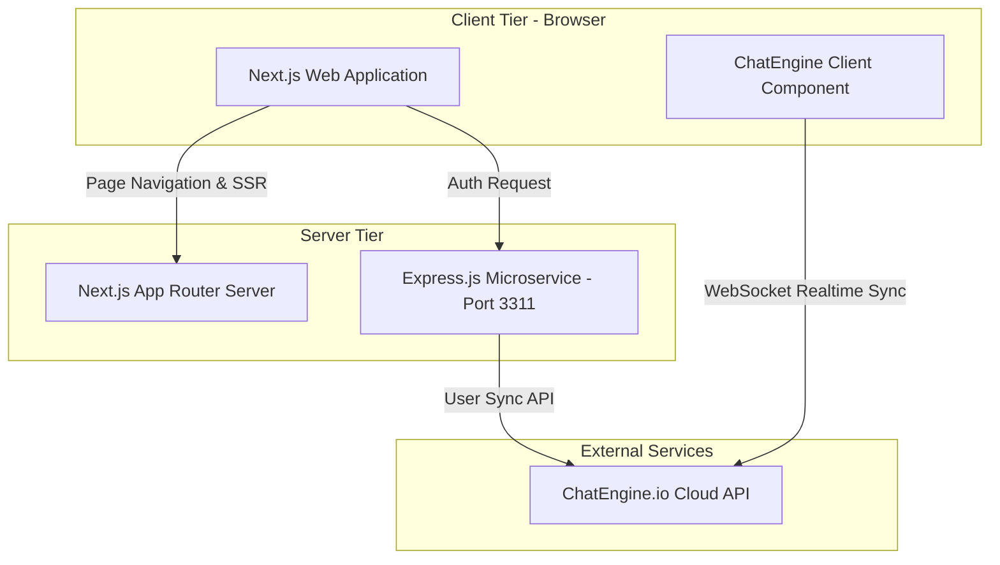

# Mata Air Senjoyo — Digital Tourism & E-Ticketing Web Application

<p align="center">
  
</p>

<p align="center">
  <strong>A modern e-ticketing platform and eco-tourism web portal for Mata Air Senjoyo (Umbul Senjoyo), Central Java.</strong>
  <br />
  Streamlining visitor reservations, digital ticket issuance, visitor engagement, and back-office administrative workflows.
</p>

<p align="center">
  
  
  
  
  
  
</p>

---

## Table of Contents

- [Overview & Business Context](#overview--business-context)
- [Key Features](#key-features)
  - [Visitor Portal (Frontend)](#1-visitor-portal-frontend)
  - [Administrative Back-Office](#2-administrative-back-office)
- [System Architecture](#system-architecture)
- [Tech Stack](#tech-stack)
- [Visual Showcase](#visual-showcase)
- [Repository Structure](#repository-structure)
- [Getting Started](#getting-started)
  - [Prerequisites](#prerequisites)
  - [Frontend Setup (Next.js)](#frontend-setup-nextjs)
  - [Backend Setup (Express.js)](#backend-setup-expressjs)
- [API & Integration Details](#api--integration-details)
- [Engineering Highlights](#engineering-highlights)
- [Roadmap for Production Scaling](#roadmap-for-production-scaling)
- [Author & Contact](#author--contact)

---

## Overview & Business Context

**Mata Air Senjoyo** (Umbul Senjoyo), situated in Tegalwaton, Semarang Regency / Salatiga, is a renowned natural spring and heritage destination in Central Java. Traditionally, eco-tourism destinations face operational challenges:
- Manual, paper-based gate ticketing leading to queue bottlenecks during peak hours.
- Lack of centralized visitor booking data for carrying-capacity management.
- Fragmented visitor communication channels for inquiries and community feedback.

**Senjoyo-WebApp** was developed as a solution to modernize the visitor journey and destination management:
1. **Digital Booking Flow**: Seamless online ticket reservation with time-slot selection and instant e-ticket generation.
2. **Visitor Information Hub**: Transparent information on amenities, FAQ, interactive galleries, and visitor guidance.
3. **Live Community Forum**: Integrated chat infrastructure enabling real-time visitor discussions and customer inquiry handling.
4. **Operations Dashboard**: Dedicated administrative back-office to oversee maintenance metrics and manage ticket records.

---

## Key Features

### 1. Visitor Portal (Frontend)
- **Interactive Landing & Discovery**:
  - Hero carousel built with `embla-carousel-react` featuring high-definition destination imagery.
  - Historical context and cultural overview (Legenda Jaka Tingkir & water heritage).
- **End-to-End E-Ticketing Pipeline**:
  - **Dynamic Reservation Form**: Visitor personal detail collection, calendar date picker, and session slot selection (`08:00`, `10:00`, `12:00`, `15:00` WIB).
  - **Interactive Ticket Counter**: Real-time price computation with min/max caps.
  - **Checkout & Payment Verification**: Automated order code generation, payment timer countdown (30 mins), and verified bank transfer instructions.
  - **Digital E-Ticket Issuance**: Unique Ticket ID tracking (`#78129837651`), schedule summaries, and guest credentials ready for on-site validation.
- **Facilities & Guidelines Directory**:
  - Clear visual amenities map: Restrooms & showers, prayer rooms (mushola), culinary stalls, spacious parking, and scenic gazebos.
  - Searchable FAQs regarding entrance tariffs (Rp 5.000/person), operational hours (`07:00 – 17:00 WIB`), and site policies.
  - In-app searchable user guide (`/dokumentasi`) with client-side text filtering.
- **Real-Time Visitor Community Forum**:
  - Direct integration with ChatEngine.io via an Express authentication bridge.
  - Real-time websocket messaging for visitor interaction and support.

### 2. Administrative Back-Office
- **Secure Admin Portal**: Dedicated administrator authentication gateway (`/admin`).
- **Operational Dashboard**: Visual metrics for maintenance monitoring and visitor throughput.
- **Ticket Records & Data Report**:
  - Tabular list of booked tickets and visitor details.
  - Data mutation capabilities: **Edit** reservation schedules (`/editadmin`) and **Delete** records with safety prompts.
- **In-App Administrator Manual**: Built-in documentation portal (`/docsadmin`) with quick keyword search.

---

## System Architecture



---

## Tech Stack

| Domain | Technology | Purpose |
|---|---|---|
| **Frontend Framework** | [Next.js 14](https://nextjs.org/) (App Router) | Server-side rendering, routing, page optimization |
| **UI Library** | [React 18](https://react.dev/) | Component architecture & state management |
| **Language** | [TypeScript](https://www.typescriptlang.org/) & JavaScript | Static typing, interface contracts, and application logic |
| **Styling** | [Tailwind CSS 3.4](https://tailwindcss.com/) + SCSS | Responsive design, modern layout system, custom design tokens |
| **UI Components** | Flowbite & Flowbite React | Accessible interactive components |
| **Carousels & Media** | Embla Carousel (`embla-carousel-react`, autoplay) | Smooth, accessible hero image carousel |
| **Backend & Microservice**| [Express.js](https://expressjs.com/) (Node.js) | Lightweight API bridge for ChatEngine user authentication |
| **Real-Time Chat** | [ChatEngine.io](https://chatengine.io/) | Managed websocket chat infrastructure & UI components |
| **HTTP Client** | [Axios](https://axios-http.com/) | API communication between client, backend, and external services |
| **Typography** | Montserrat (`next/font/google`) | Optimized typography loading with zero layout shift |

---

## Visual Showcase

| Home & Destination Highlights | E-Ticketing Form |
|:---:|:---:|
|  |  |

| Payment Verification | Digital E-Ticket |
|:---:|:---:|
|  |  |

| Facilities Directory | Admin Dashboard |
|:---:|:---:|
|  |  |

---

## Repository Structure

```text
Senjoyo-WebApp/
├── app/                        # Next.js 14 App Router Directory
│   ├── layout.tsx              # Root layout with Montserrat typography & global styling
│   ├── page.tsx                # Public landing page (Hero, carousel, heritage summary)
│   ├── globals.css             # Tailwind base layers and customized utility classes
│   ├── data.js                 # Visitor documentation & guide dataset
│   ├── admin.js                # Admin portal documentation dataset
│   ├── admin/                  # Admin authentication page
│   ├── dashboard/              # Admin analytics & operational dashboard
│   ├── maintenance/            # System & site maintenance metrics
│   ├── report/                 # Ticket booking records management (CRUD view)
│   ├── editadmin/              # Ticket update / modification interface
│   ├── docsadmin/              # In-app administration guidelines with live search
│   ├── pesan/                  # Ticket ordering form with date/time pickers
│   ├── detail/                 # Order summary & payment gateway instructions
│   ├── etiket/                 # Issued digital ticket view with unique identifier
│   ├── fasilitas/              # Eco-tourism facilities and amenities showcase
│   ├── faq/                    # Frequently asked questions & operational regulations
│   ├── dokumentasi/            # Visitor guidance and tutorial portal
│   ├── forum/                  # Real-time community discussion forum
│   │   ├── AuthPage.jsx        # Forum username login / register trigger
│   │   ├── ChatsPage.jsx       # Integrated ChatEngine socket & chat room view
│   │   └── page.jsx            # State toggle between Auth & Chat views
│   └── components/             # Reusable UI component library
│       ├── Headers.tsx         # Main responsive navigation header
│       ├── Footers.tsx         # Site footer with operational details & social links
│       ├── HeadersAdmin.tsx    # Administrator header component
│       ├── HeaderAdmin1.tsx    # Minimalist admin login header
│       ├── Carousel.tsx        # Embla carousel with autoplay integration
│       ├── Quantity.tsx        # Controlled ticket counter component
│       ├── Form.jsx            # Controlled booking form implementation
│       ├── Search.tsx          # Client-side searchable documentation list
│       └── SearchAdmin.tsx     # Admin documentation search module
├── backend/                    # Standalone Node.js / Express microservice
│   ├── index.js                # Express app & ChatEngine user authentication route
│   ├── package.json            # Backend dependencies (express, cors, axios, nodemon)
│   └── req.rest                # REST Client testing file for API endpoints
├── public/                     # Static assets (images, SVGs, logos, icons)
│   └── assets/                 # Gallery imagery, brand logo, and feature mockups
├── next.config.mjs             # Next.js configuration
├── tailwind.config.ts          # Tailwind CSS design system tokens and content paths
├── tsconfig.json               # TypeScript compiler configurations
└── package.json                # Frontend dependencies and development scripts
```

---

## Getting Started

### Prerequisites
Make sure you have the following installed on your machine:
- **Node.js**: `v18.17.0` or higher
- **npm** (or `yarn`, `pnpm`, `bun`)
- **Git**

### Frontend Setup (Next.js)

1. **Clone the repository**:
   ```bash
   git clone https://github.com/yogibagas19/Senjoyo-WebApp.git
   cd Senjoyo-WebApp
   ```

2. **Install frontend dependencies**:
   ```bash
   npm install
   ```

3. **Run the Next.js development server**:
   ```bash
   npm run dev
   ```

4. **Access the application**:
   Open [http://localhost:3000](http://localhost:3000) in your web browser.

---

### Backend Setup (Express.js)

The forum / community chat requires the Express authentication microservice:

1. **Navigate to the backend directory**:
   ```bash
   cd backend
   ```

2. **Install backend dependencies**:
   ```bash
   npm install
   ```

3. **Start the Express server**:
   ```bash
   npm run dev
   ```
   *The backend will boot up on `http://localhost:3311`.*

---

## API & Integration Details

### Chat Authentication Endpoint
- **URL**: `POST http://localhost:3311/auth`
- **Payload**:
  ```json
  {
    "username": "johndoe"
  }
  ```
- **Behavior**: Calls `https://api.chatengine.io/users/` using an upsert mechanism (`axios.put`) to register or authenticate the user on the ChatEngine cluster, returning user metadata and token for the frontend socket connection.

---

## Engineering Highlights

1. **Modern App Router Paradigm**: Leverages Next.js 14 App Router conventions for clean routing, page-specific metadata (`title`), and streamlined layouts.
2. **Component Reusability & Modularity**: Reusable UI blocks (`Quantity.tsx`, `Carousel.tsx`, `Search.tsx`) separated from page containers to promote maintainability and testability.
3. **Optimized Asset Delivery**: Utilizes `next/image` and SVG vector assets to reduce page weight and prevent layout cumulative shift (CLS).
4. **Hybrid Rendering Strategy**: Balances server components for SEO-rich public pages with client components (`"use client"`) where interactive state (counters, filtering, chat sockets) is required.
5. **Decoupled Real-Time Architecture**: Separates the chat identity orchestration into a lightweight Express microservice, keeping the frontend decoupled and resilient.

---

## Roadmap for Production Scaling

- [ ] **Payment Gateway Integration**: Connect with Indonesian payment providers (Midtrans / Xendit) for automatic payment callback verification & QRIS generation.
- [ ] **Persistent Database Layer**: Replace static demo records with PostgreSQL / MongoDB via Prisma ORM for transaction history and ticket state management.
- [ ] **QR Code Verification Engine**: Embed scannable dynamic QR codes into issued e-tickets for mobile scanner validation at the physical turnstiles.
- [ ] **Role-Based Access Control (RBAC)**: Secure admin routes using Next.js Middleware and JWT / NextAuth session guards.

---

## Author & Contact

**Yogi Bagas**
- **GitHub**: [@yogibagas19](https://github.com/yogibagas19)
- **Email**: [yogibagas1945@gmail.com](mailto:yogibagas1945@gmail.com)
- **Project Repository**: [https://github.com/yogibagas19/Senjoyo-WebApp](https://github.com/yogibagas19/Senjoyo-WebApp)

---

<p align="center">
  <sub>Crafted with passion for tourism digitalization & sustainable heritage preservation.</sub>
</p>

